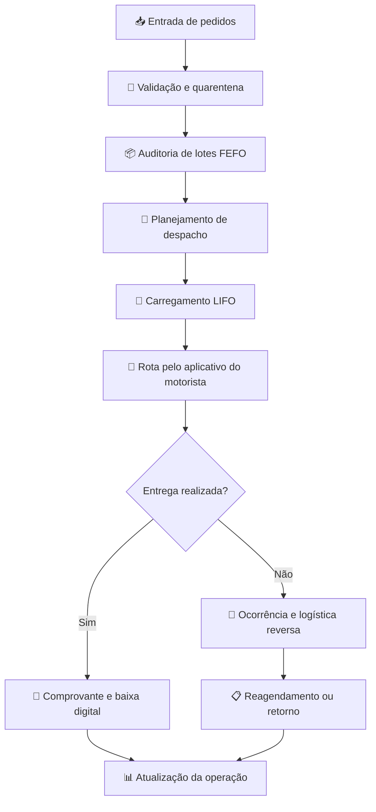

# 🚚 LogisticMaster

### Sistema inteligente de gestão e execução logística para pequenas distribuidoras B2B.

**Do pedido à baixa da entrega: menos desperdício, mais rastreabilidade e decisões orientadas à margem.**

[](https://nodejs.org/)


**[📂 Código-fonte](https://github.com/gab3souzza/logistic-master) · [📐 Especificação técnica](docs/ESPECIFICACAO-DO-PROTOTIPO.md) · [🧪 Relatório de validação](docs/RELATORIO-DE-VALIDACAO.md)**

---

## 🎯 O problema

Pequenas distribuidoras de alimentos que operam com frotas de 1 a 5 caminhões frequentemente dependem de planilhas, pranchetas e conversas no WhatsApp para organizar suas entregas.

O resultado são falhas operacionais que consomem a margem de lucro:

| Problema | Consequência operacional |
|---|---|
| 🚛 Carregamento desordenado | Mercadorias ficam soterradas e aumentam o tempo de descarga. |
| ⏳ Falta de rastreabilidade FEFO | Produtos próximos do vencimento permanecem parados no estoque. |
| 🔁 Entregas frustradas | Portas fechadas, recusas e janelas perdidas provocam reentregas. |
| 📉 Decisões sem análise de margem | Fretes extras e desvios podem transformar entregas em prejuízo. |

O projeto utiliza uma estimativa operacional de aproximadamente **R$ 89,00 por ocorrência de reentrega**, considerando combustível e horas de trabalho. É uma referência ilustrativa, não um valor universal de mercado.

### A proposta

O LogisticMaster organiza a operação física da distribuidora em um único fluxo digital, conectando pedidos, estoque, planejamento de carregamento, motoristas e comprovantes de entrega.

**A ideia central é simples: proteger a margem antes que o caminhão saia do galpão e acompanhar a operação até a última entrega.**

---

## ⚙️ Como funciona

O sistema acompanha o ciclo logístico de ponta a ponta:



### 1. Central de Operações — Web Desktop

O painel administrativo concentra o controle da operação.

**Entrada e validação de pedidos**
- Cadastro manual e importação de arquivos CSV, JSON e XML de NF-e.
- Leitura de informações de rastreabilidade, incluindo `rastro`, `nLote` e `dVal`, quando disponíveis no XML.
- API REST para integração com sistemas externos.
- Integração preparada para recebimento de pedidos pelo WhatsApp Cloud API.

**Auditoria de estoque e FEFO**
- Pedidos incompletos são direcionados para `pendente_complemento`.
- Lotes com validade igual ou inferior a 65 dias recebem prioridade urgente.
- Lotes vencidos recebem bloqueio operacional automático (`bloqueio_fiscal`).
- Priorização de saída conforme o vencimento: First Expire, First Out (FEFO).

**Motor de despacho e carregamento**
- Agrupamento de entregas por bairro e raio geográfico.
- Respeito aos limites de peso bruto e cubagem do veículo.
- Priorização de pedidos reagendados para D+1.
- Ordenação reversa das paradas para facilitar a descarga na sequência da rota.
- Posição 1 do carregamento junto à porta do baú, priorizando o primeiro destino.

**Calculadora Hoje vs. Amanhã**
- Compara o custo do envio imediato com a possibilidade de consolidação no próximo dia.
- Considera quilometragem adicional, horas da equipe e frete avulso.
- Apresenta uma recomendação baseada na margem líquida estimada.
- Envio contrário à recomendação exige autorização do perfil `MANAGER`.

**Logística reversa e ocorrências**
- Registro de mercadorias retornadas.
- Classificação entre `reagendado_d1` e `baixado_avaria`.
- Atualização da disponibilidade física da carga no veículo.
- Regra operacional de corte de 500 metros para cancelamentos em trânsito.

### 2. Aplicativo do Motorista — PWA Offline-First

O motorista utiliza uma aplicação web instalável, projetada para continuar operando mesmo com instabilidade de conexão.

**Recursos disponíveis:**
- Romaneio digital vinculado ao motorista.
- DANFE em PDF disponível offline.
- Armazenamento local de documentos e eventos com IndexedDB.
- Sincronização automática das operações pendentes.
- Geolocalização e validação de geofence de 30 metros.
- Entregas integrais ou parciais.
- Registro fotográfico obrigatório nas baixas previstas pelo fluxo.
- Assinatura manuscrita em canvas.
- Identificação dos eventos por `clientEventId` para processamento idempotente.
- Abertura de rotas e destinos no Waze e Google Maps.

**Comunicação operacional com um toque:**

| Ação | Finalidade |
|---|---|
| 📍 Cheguei | Informa a chegada ao destino. |
| ⏳ Aguardando | Comunica uma espera no cliente. |
| 🆘 Preciso de ajuda | Solicita suporte à central. |
| ➡️ Próxima parada | Atualiza o andamento da rota. |

A fila offline isola erros definitivos, como respostas HTTP `4xx`, para revisão posterior, sem interromper a sincronização dos demais eventos.

---

## 🧠 Engenharia e decisões técnicas

Mais do que uma interface de gestão, o projeto reúne mecanismos de controle operacional, integração e resiliência.

| Camada | Implementação | Objetivo |
|---|---|---|
| Interface | React + TypeScript + Vite | Aplicação web modular e tipada. |
| Backend | Node.js + Express | API e regras de negócio centralizadas. |
| Persistência | SQLite + WAL | Armazenamento transacional do protótipo. |
| Autenticação | `scrypt` + sessão HttpOnly | Proteção de credenciais e sessões. |
| Controle de acesso | RBAC no backend | Permissões conforme o perfil do usuário. |
| Operação offline | PWA + Service Worker + IndexedDB | Continuidade operacional sem conexão. |
| Integridade | SHA-256 | Identificação de alterações nos registros de evidência. |
| Integrações | REST API + Webhooks | Comunicação com serviços externos. |

### 🔐 Segurança e integridade

O projeto incorpora mecanismos específicos para reduzir riscos de acesso indevido e inconsistência operacional:

- **RBAC:** autorização aplicada no backend, não apenas na interface.
- **Senhas:** armazenamento com derivação criptográfica usando `scrypt`.
- **Sessões:** utilização de cookies `HttpOnly`.
- **API Keys:** armazenamento somente do hash SHA-256 da chave.
- **Webhooks:** validação da assinatura `X-Hub-Signature-256` da Meta.
- **Idempotência:** identificação única dos eventos offline por `clientEventId`.
- **Evidências:** arquivos de fotos, PDFs e assinaturas armazenados separadamente dos registros JSON do banco.

> A geração de hash SHA-256 para uma assinatura manuscrita auxilia na identificação de alterações no registro, mas não equivale, isoladamente, a uma assinatura digital certificada ou à comprovação jurídica da identidade do signatário.

---

## 👥 Controle de acesso — RBAC

O sistema possui quatro perfis operacionais, com permissões específicas:

| Perfil | Responsabilidade | Usuário de demonstração |
|---|---|---|
| `MANAGER` | Dashboard, pedidos, clientes, frota, despacho, indicadores, integrações, usuários e parâmetros. | `gestor@logisticmaster.local` |
| `DISPATCHER` | Pedidos, clientes, frota, planejamento de carga, mapa, comunicação e logística reversa. | `despacho@logisticmaster.local` |
| `DRIVER` | Romaneio, documentos offline, geolocalização, entregas, assinaturas e ocorrências. | `motorista@logisticmaster.local` |
| `SALES_REP` | Cadastro e consulta de pedidos e clientes, com edição antes da alocação. | `vendas@logisticmaster.local` |

**Credencial de demonstração:** `Demo@123` para os usuários listados.

Essas contas são destinadas exclusivamente à avaliação do protótipo. Não utilize essas credenciais em um ambiente de produção.

---

## 🏗️ Arquitetura do projeto

A estrutura foi organizada para separar interface, regras operacionais, integração e persistência.

```text
logistic-master/
│
├── Dockerfile
├── render.yaml
│
├── docs/
│   ├── ESPECIFICACAO-DO-PROTOTIPO.md
│   └── RELATORIO-DE-VALIDACAO.md
│
├── public/
│   ├── manifest.json
│   └── sw.js
│
├── server/
│   ├── index.mjs
│   └── dev.mjs
│
└── src/
    ├── data/
    │   └── mockData.ts
    │
    └── platform/
        ├── PlatformApp.tsx
        ├── Views.tsx
        ├── LoginScreen.tsx
        ├── api.ts
        ├── offlineQueue.ts
        └── types.ts
```

### Responsabilidade dos principais módulos

| Arquivo | Responsabilidade |
|---|---|
| `server/index.mjs` | API Express, autenticação, banco SQLite, regras FEFO/LIFO e armazenamento de evidências. |
| `server/dev.mjs` | Inicialização coordenada do backend e frontend. |
| `PlatformApp.tsx` | Aplicação principal, navegação por perfil e sincronização. |
| `Views.tsx` | Interfaces dos módulos operacionais. |
| `LoginScreen.tsx` | Autenticação e gerenciamento de sessão. |
| `api.ts` | Cliente HTTP tipado para comunicação com a API. |
| `offlineQueue.ts` | Fila de eventos offline e cache de PDFs. |
| `types.ts` | Contratos e estruturas de dados TypeScript. |

---

## 🔌 Integrações

### API REST

O sistema disponibiliza um ponto de entrada para integração com sistemas externos:

```http
POST /api/integrations/orders
X-API-Key: SUA_CHAVE_DE_INTEGRACAO
Content-Type: application/json
```

As chaves de integração são armazenadas como hash SHA-256, em vez de serem persistidas em texto puro.

### WhatsApp Cloud API — Meta

A integração permite receber eventos de pedidos por webhook, com validação da assinatura HMAC `X-Hub-Signature-256`.

Variáveis necessárias:

```env
WHATSAPP_ACCESS_TOKEN=
WHATSAPP_PHONE_NUMBER_ID=
WHATSAPP_API_VERSION=
WHATSAPP_VERIFY_TOKEN=
WHATSAPP_APP_SECRET=
```

A integração depende da configuração das credenciais e do ambiente da Meta.

---

## 🚀 Executar localmente

### Requisitos

- Node.js `>= 22.5.0`
- npm
- Git

O projeto utiliza o módulo nativo `node:sqlite`, por isso exige uma versão compatível do Node.js.

### 1. Clonar o repositório

```bash
git clone https://github.com/gab3souzza/logistic-master.git

cd logistic-master
```

### 2. Instalar as dependências

```bash
npm install
```

### 3. Iniciar a aplicação

```bash
npm run dev
```

O comando inicia o backend e o frontend simultaneamente.

### 4. Acessar

| Serviço | Endereço |
|---|---|
| Aplicação web | http://localhost:3000 |
| API | http://localhost:4000 |

Na primeira execução, o sistema cria automaticamente o banco SQLite e os usuários de demonstração.

### Configuração opcional

As variáveis de ambiente podem ser consultadas em `.env.example`.

Para habilitar a integração com WhatsApp, configure as credenciais da Meta em um arquivo `.env` local. Não publique tokens ou segredos no repositório.

---

## ☁️ Deploy de homologação

O repositório já possui configuração para execução utilizando Docker e Render.

Arquivos de configuração:

- `Dockerfile`: build e execução com Node.js 22.
- `render.yaml`: configuração de deploy via Blueprint.

### Publicação no Render

1. Acesse [Render](https://render.com/).
2. Selecione **New + → Blueprint** ou **Web Service → Docker**.
3. Conecte o repositório `gab3souzza/logistic-master`.
4. Permita que o Render utilize o `render.yaml` para configurar o serviço.
5. Configure as variáveis de ambiente necessárias.

**Atenção à persistência:** o sistema utiliza SQLite no protótipo. O armazenamento local de planos com sistema de arquivos efêmero pode ser perdido após reinicializações ou novos deploys.

Para uma homologação com persistência, configure um volume em:

```text
/app/server/data
```

A evolução para PostgreSQL e Object Storage está prevista no roadmap.

---

## 🛣️ Roadmap — Próximos marcos

O protótipo estabelece a base operacional. Os próximos passos concentram-se em escalabilidade, validação física e robustez para uso comercial.

- [ ] **PostgreSQL multi-tenant:** substituir a persistência SQLite por banco relacional normalizado, com DDL, triggers PL/pgSQL e suíte de testes `pgTAP` especificados.
- [ ] **Empilhamento físico inteligente:** validar resistência das embalagens e regras `HEAVY_BASE` / `FRAGILE_TOP` (RN-02.1).
- [ ] **Roteirização avançada:** integrar matriz real de distâncias, monitoramento contínuo de ETA e polígonos oficiais da ZRTC de Salvador (RN-06).
- [ ] **Object Storage:** migrar fotos, PDFs e assinaturas para S3/R2, com políticas de retenção e auditoria LGPD.
- [ ] **Validação em campo:** testar os fluxos com uma operação real de distribuição e confrontar os resultados com indicadores operacionais.

---

## 📚 Documentação complementar

O repositório conta com documentação específica para aprofundamento técnico e avaliação do projeto:

- [`ESPECIFICACAO-DO-PROTOTIPO.md`](docs/ESPECIFICACAO-DO-PROTOTIPO.md) — requisitos, regras de negócio e especificação funcional.
- [`RELATORIO-DE-VALIDACAO.md`](docs/RELATORIO-DE-VALIDACAO.md) — relatório de validação do protótipo.

---

## 👨‍💻 Autoria e desenvolvimento

Projeto idealizado e conduzido por **Gabriel Santana Souza**, desenvolvido no âmbito do curso de **Análise e Desenvolvimento de Sistemas — UCSAL**, na disciplina CST300.

**Equipe de desenvolvimento:**
- Gabriel Santana Souza
- Raiana Firmino Lima
- Glauco Helder Drumond da Encarnação

**Repositório:** [github.com/gab3souzza/logistic-master](https://github.com/gab3souzza/logistic-master)

---

<p align="center">
  <strong>LogisticMaster — Logística inteligente, margem protegida.</strong>
  <br>
  <sub>Da entrada do pedido à comprovação da entrega.</sub>
</p>
